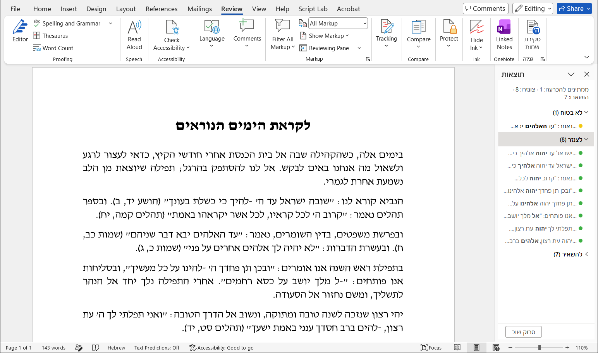
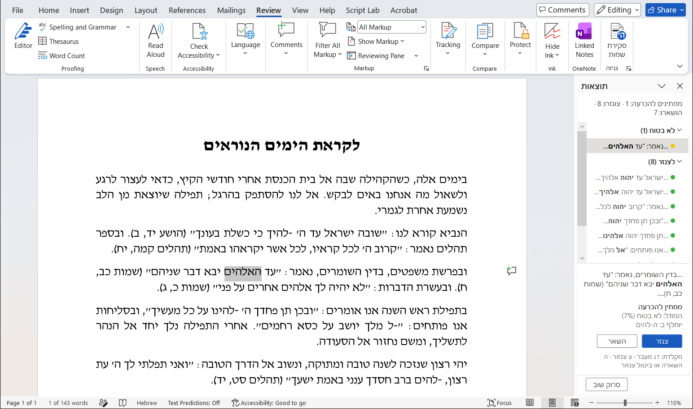
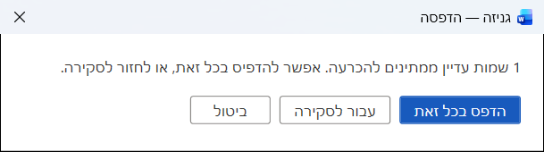
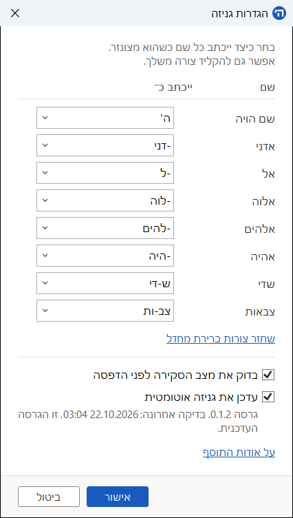

# Genizah

[](https://github.com/Pituchey-Hotam/Genizah/releases/latest)

Genizah is a Word add-in that automatically finds divine names in Hebrew documents and changes
their spelling, including names that require understanding the context.

Finding these names takes more than search and replace: אל can be a preposition, and אלהים can
refer to judges or foreign gods. Genizah uses a completely local AI model trained on the Hebrew Bible, prayer
books and modern Torah articles to estimate whether each occurrence is a divine name. It
changes likely divine names to modified spellings, leaves likely ordinary uses, and asks you
to review uncertain cases. The model runs entirely on your computer; your text is never sent
to an external service. Only update checks need an internet connection.



## Genizah in action

Click <strong>סקירת שמות</strong> in the <strong>גניזה</strong> group on Word's
<strong>סקירה</strong> (Review) tab to scan the document and open the review pane.

<table>
<tr>
<td width="65%" valign="top">
<p><strong>Review the results.</strong> Names are grouped as <strong>לצנזר</strong> (censored
automatically), <strong>להשאיר</strong> (left unchanged), or <strong>לא בטוח</strong> (needs your
decision). Select a row to jump to its place in the document, then choose <strong>צנזר</strong>
or <strong>השאר</strong>. You can change any decision and restore censored names.</p>
<a href="docs/images/review-ask.png"></a>
<p><strong>Print with a final check.</strong> If names still need a decision, or the document
hasn't been reviewed, Genizah asks before printing.</p>
<a href="docs/images/print-check.png"></a>
</td>
<td width="35%" valign="top">
<p><strong>Choose your settings.</strong> Open the small arrow in the <strong>גניזה</strong>
ribbon group to choose each name's spelling, toggle print checks and automatic updates,
and see the installed version and update status.</p>
<a href="docs/images/settings.png"></a>
</td>
</tr>
</table>

## Installing

Download `Genizah-Setup-<version>.exe` from the
[latest release](https://github.com/Pituchey-Hotam/Genizah/releases/latest) and run it. It
needs Word for Windows (64-bit). The model is included and runs on your own computer, so your
documents never leave it and no internet connection is needed. When one is available, Genizah
updates itself in the background.

**Genizah is an aid, not a guarantee.** It can censor nondivine words; and in rare cases miss a name.
Review the results before relying on it.

## Halachic background

Maimonides (רמב״ם, הלכות יסודי התורה ו, ב) rules that erasing one of the seven
divine names is prohibited מדאורייתא; this is also codified in the
שו״ע. Authorities disagree about biblical verses and Torah writings that do not
contain divine names. They agree that treating such writings disrespectfully or discarding
them is prohibited, but differ over the status and conditions of that prohibition.

The add-in was written for the practice followed at Yeshivat Birkat Moshe in Ma'ale Adumim,
based on the ruling of its Rosh Yeshiva, Rabbi Nahum Eliezer Rabinovitch (שו״ת שיח נחום, סימן עד).
Following Maimonides, he ruled that the prohibition concerning Torah writings
without divine names is rabbinic. Under the conditions detailed in that responsum, such pages
may therefore be placed in the trash or recycled respectfully. In contrast, for pages containing
explicit divine names require genizah מדאורייתא, must be treated as Shemot and be disposed of accordingly.

**The add-in does not guarantee that a document is exempt from genizah according to every
opinion.** Some authorities hold that all Torah writings require genizah; according to that
view, changing the names does not remove the requirement. Each user should consult the
halachic authority they follow.

## For developers

Building needs Visual Studio with the Office/SharePoint development workload.

```
powershell -File tools/dist/fetch_model.ps1      # the model graph (~100 MB, not in git)
MSBuild.exe Genizah/Genizah.csproj -restore      # not `dotnet build`: VSTO needs MSBuild
dotnet test Genizah.Core.Tests                   # net48 and net7.0
```

- `Genizah/`: the VSTO add-in (.NET Framework 4.8, x64): ribbon, scanning, review pane.
- `Genizah.Core/`: the classifier's input pipeline and ONNX scoring, with no Office dependency
  (netstandard2.0 and net48).
- `Genizah.Core.Tests/`: xUnit, against test vectors generated from the training code.
- `model/`: vocabulary, manifest and per-name thresholds. The `.onnx` graph is fetched.
- `tools/`: release scripts (`dist/`) and a scan benchmark that drives Word (`benchmark/`).

Releases and updates: [`docs/RELEASING.md`](docs/RELEASING.md).

## License and credits

Apache License 2.0 (`LICENSE`), for the code and the model. The model is built on DICTA's
BEREL 3.0 and learned from the hand-censored issues of עולה מן המדבר, the journal of ישיבת
ברכת משה, and from the Hebrew Bible and vocalized liturgy. `NOTICE` credits them all, along with the
third-party software shipped with the add-in, whose licenses are in `licenses/`.
